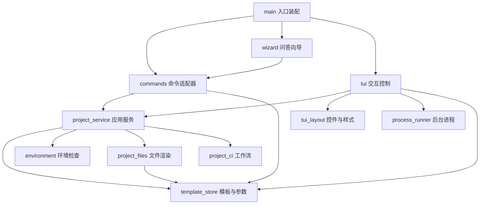

# rdk 目录结构与依赖方向

```text
rdk/
├── docs/                         使用、架构与验收文档
├── rdk_cli/
│   ├── main.py                   Typer 入口装配，选择命令/问答/工作台
│   ├── commands/
│   │   ├── common.py             命令错误展示
│   │   ├── projects.py           项目命令：参数转换、调用服务、展示结果
│   │   └── templates.py          模板管理命令
│   ├── wizard.py                 兼容旧终端的逐步问答，复用命令适配器
│   ├── tui.py                    工作台交互控制、表单与任务状态
│   ├── tui_layout.py             Textual 控件树、样式与布局
│   ├── process_runner.py         异步日志流、取消、整个进程组清理
│   ├── terminal.py               Rich 表格、边框与问答高亮
│   ├── project_service.py        项目请求、预检计划、生成编排、冒烟测试
│   ├── project_files.py          文件渲染、ROS package.xml 依赖补全
│   ├── project_ci.py             生成项目的 CI 工作流内容
│   ├── template_store.py         版本、参数、状态、评审、Git/注册表导入
│   ├── registry.py               旧登记表导入兼容入口
│   └── environment.py            ROS 环境检测与领域异常
├── templates/                    以 rdk_templates 包随 wheel 分发
│   ├── ros2-python/              Python 节点、参数、Launch、pytest
│   ├── ros2-cpp/                 C++17 节点、参数、Launch、gtest
│   ├── ros2-bringup/             多节点启动、机器人配置与测试
│   └── pytorch-training/         Dataset、模型、训练、评测与测试
├── tests/
│   ├── test_cli.py               命令和 ROS 环境检查
│   ├── test_templates.py         生命周期、版本、参数、导入、问答向导
│   ├── test_project_service.py   无界面依赖、预检无副作用、CLI/服务生成一致性
│   ├── test_packaging.py         wheel 安装后的资源定位与生成
│   ├── test_smoke.py             真实 ROS 构建运行与 CPU 训练评测
│   └── test_tui.py               控件交互、真实生成、取消与退出清理
└── pyproject.toml                打包配置与命令入口
```



箭头表示导入依赖。核心服务不导入 `main`、Typer、Rich 或 Textual；环境检查抛出
`EnvironmentCheckError`，由命令或界面负责展示。新增生成规则应放入服务/模板模块，避免在 CLI 和 TUI 各写一份。

项目创建分为三个阶段：

1. `ProjectRequest` 收集模板引用、名称、参数和生成选项。
2. `prepare_project` 统一校验模板状态、参数、输出位置及环境，返回 `ProjectPlan`；预检不创建目录。
3. `create_project` 执行生成；可选调用 `run_smoke_tests`。生成失败保留文件并报告错误，不自动覆盖已有项目。

TUI 在启动任务前使用同一个服务预检；实际生成和导入通过 `ProcessRunner` 在独立进程组中调用
`python -m rdk_cli.main`，以便流式展示日志、取消 colcon/CMake/Git 等后代进程。
这是运行时的子进程边界，TUI 不导入主入口，不产生 Python 循环导入。

修改界面外观时编辑 `tui_layout.py`；修改交互事件时编辑 `tui.py`；修改进程清理时编辑
`process_runner.py`。旧问答向导复用命令适配器，保持提示、错误输出及命令行为一致。

每个模板的 `template.json` 是元数据和参数定义的唯一来源。
ROS 项目先由 `ros2 pkg create` 创建标准骨架，再叠加模板内容；PyTorch 与通用目录模板直接复制渲染。
生成后写入 `.robot-cli.json` 记录确切版本和参数。生成项目不导入 `rdk_cli`，可脱离本仓库构建和运行。

仓库根目录 `.github/workflows/templates.yml` 包含 CLI/wheel、CPU PyTorch 和 ROS Jazzy 自动验证。
团队模板存储在用户数据目录，独立于源码仓库；使用方式见 `template-management.md`。
