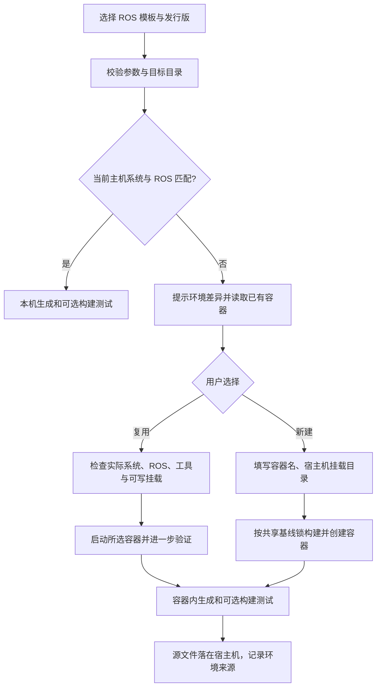

# 开发环境管理

默认使用 **CPU**。GPU 是独立可选配置，不影响 ROS 包的普通创建、构建和测试。
Humble（兼容输入 `hamble`）对应 Ubuntu 22.04 + Python 3.10；Jazzy 对应 Ubuntu 24.04 + Python 3.12。
不要在 Ubuntu 24.04 的系统 Python 中混装 Humble Python 绑定。

## 项目创建时自动选择环境



在 Ubuntu 24.04 + Jazzy 上创建 Jazzy 包直接运行：

```bash
source /opt/ros/jazzy/setup.bash
robot-cli project create ros2-cpp@1.1.0 --name demo_jazzy --ros-distro jazzy --output ./ws/src --smoke-test
```

创建 Humble 包时，交互终端会提示差异，让你选择已有容器或填写新容器名、挂载目录。
TUI 先展开“容器环境 / 已有容器”，读取现有容器，检查配置后再次点击“创建项目”。
Ubuntu 22.04 + Humble 创建 Jazzy 包时流程完全对称。

非交互脚本必须显式选择容器，避免自动安装或等待输入：

```bash
robot-cli project create ros2-cpp@1.1.0 --name demo_humble --ros-distro humble \
  --output ./humble_ws/src --container --container-name my-humble-dev \
  --mount ./humble_ws --smoke-test --ci
```

新容器将宿主机挂载目录映射为 `/workspace`，使用当前 UID/GID 写入，输出位置必须在挂载目录内。
`--host-only` 禁止切换到容器；容器内再次调用生成命令时使用该选项避免递归。
本机已安装正确 ROS 但终端未加载时，先 source 对应 setup.bash，或使用 `env shell`。

## 读取和复用已有容器

```bash
robot-cli env containers ros2-humble-dev
robot-cli env containers ros2-jazzy-dev --json
robot-cli project create ros2-cpp@1.1.0 --name demo_existing --ros-distro humble \
  --output /path/to/existing/bind/src --reuse-container existing-humble --smoke-test
```

发现阶段只执行 Docker 查询和文件读取，**不启动停止中的容器**，也不依据镜像名猜测 ROS。
运行中的容器会进一步探测 Python 绑定与构建工具；停止的容器先核对 `/etc/os-release` 和 ROS setup 文件，
只有用户选择复用后才启动，并验证构建工具、venv/ensurepip 等条件。

已有容器的挂载保持原样。选择输出目录时必须落在某个可写 bind mount 内，工具自动映射到实际容器路径。
不符合时拒绝生成，不会删除或重建业务容器。不能把新建的 `--mount` 与 `--reuse-container` 混用。
复用路线在容器 `/tmp/robot-cli-*` 下安装隔离 CLI，不修改系统 Python 或 APT；已有依赖缺失时报告问题。
已有外部容器不是锁定环境，会在生成项目 `.robot-cli.json` 的 `development_environment` 中标记
`reproducible: false`。临时 CLI 可重新安装；源代码保存在原有挂载中。

## 环境命令

```bash
robot-cli env list
robot-cli env doctor ros2-jazzy-dev
robot-cli doctor ros2-humble-dev --template ros2-cpp@1.1.0 --json --output ./doctor.json
robot-cli env init all --workspace .
robot-cli env build ros2-humble-dev
robot-cli env shell ros2-humble-dev --workspace .
robot-cli env verify ros2-humble-dev --workspace .
```

- `doctor` 只读检查 OS、Python、ROS 绑定/构建工具、Docker daemon/权限；GPU 配置额外检查驱动、runtime 与宿主机 CUDA 计算。
- 报告分别给出宿主机开发条件与容器条件，宿主机合格时不因 Docker 缺失而报整体失败；两条路线都不满足时退出码为 1。
- `init all` 默认准备 Humble/Jazzy 两套 **CPU** 环境。宿主机合格则跳过相应容器，否则创建工具管理的持久容器。
- `build` 只构建镜像；`init` 创建容器；`shell` 打开交互终端；`verify` 实际生成并构建测试三种 ROS 模板。
- `--container` 可强制使用容器，即使宿主机已合格；不同工作目录使用不同默认容器名。
- 模板 `1.0.0` 的 Jazzy 约束保持不变；新 `1.1.0` 支持 Humble/Jazzy，默认仍为 Jazzy。

默认环境文件保存在当前目录 `.robot-cli/environments/<profile>/1.0.0/`，已加入 Git 忽略。
可以使用 `--root ./team-environments` 输出到团队希望评审和版本管理的位置。
普通用户需要有 Docker socket 权限；工具不会自动 sudo、修改用户组、安装驱动或重启 Docker。

## Dockerfile、Dev Container 与锁文件

```bash
robot-cli env configure ros2-humble-dev --root ./team-environments
# 在 VS Code 中选择生成的 .devcontainer/devcontainer.json，或使用：
devcontainer up --workspace-folder . \
  --config ./team-environments/ros2-humble-dev/1.0.0/.devcontainer/devcontainer.json
```

导出包含 Dockerfile、`.devcontainer/devcontainer.json`、可独立安装的 CLI/模板副本、
`environment.lock.json`、`apt.lock`、`requirements.lock`、`framework.lock` 和变更日志。
Dev Container 的构建 context 是配置父目录；工作空间挂载用户传入的 workspace folder。
Dev Container 默认以 root 连接，团队可在配置评审时设置合适的 `remoteUser`；CLI 创建的容器使用宿主机 UID/GID。

CPU 发布基线随安装包提供：基础镜像固定 registry digest，APT 安装事务中新增/升级的全部包精确固定版本，
基础镜像已有包由 digest 固定。ROS 仓库公钥按 SHA256 校验；Python CLI 和测试依赖及训练依赖精确固定版本。
不同机器首次配置也使用同一发布基线，**不会各自解析 latest**。

构建后在镜像 `/opt/robot-cli/` 保存环境锁、完整 dpkg/Python 清单。
本地 `build.json` 记录镜像 ID，`verification.json` / `host-verification.json` 记录实际验收结果。
镜像标签包含 `1.0.0-<锁摘要>`，同名容器的锁或挂载不符时拒绝覆盖。

更新依赖必须显式执行：

```bash
robot-cli env configure ros2-humble-dev --root ./team-environments --update-lock
robot-cli env build ros2-humble-dev --root ./team-environments --container
```

`--update-lock` 才会重新解析上游镜像标签、ROS 公钥与 APT 安装事务，并在 `history/` 记录前后锁。
CLI 源码或上下文被修改时会拒绝使用旧锁，要求显式更新。
更新上游后应评审锁差异、执行 `env verify`，再由维护者发布新的环境版本/基线。
上游撤下某个 APT 精确版本时构建会明确失败，不会静默换包；长期复现还应使用团队 APT/Python 镜像与制品归档。
精确 Python 版本锁不等于跨平台二进制认证，当前基线面向 **linux/amd64**。

## 可选的 PyTorch 和 GPU

普通 ROS CPU 镜像不安装 PyTorch，按需选用：

```bash
robot-cli env build ros2-humble-dev --container --with-torch --update-lock
robot-cli env verify ros2-humble-dev --with-torch
```

GPU **不会由 `init all` 自动准备**。当前 GPU 配置为待硬件验收的可选配置，尚无已发布共享基线锁，
需要显式解析、评审后使用：

```bash
robot-cli env doctor ros2-jazzy-dev-gpu
robot-cli env configure ros2-jazzy-dev-gpu --update-lock
robot-cli env build ros2-jazzy-dev-gpu --container
robot-cli env verify ros2-jazzy-dev-gpu --container
```

| 环境 | 系统 / ROS | CUDA 用户态 | 宿主机驱动最低版本 | 锁定 PyTorch |
| --- | --- | --- | --- | --- |
| ros2-humble-dev | Ubuntu 22.04 / Humble | 不要求 | 不要求 | 可选 2.6.0+cpu |
| ros2-jazzy-dev | Ubuntu 24.04 / Jazzy | 不要求 | 不要求 | 可选 2.6.0+cpu |
| ros2-humble-dev-gpu | Ubuntu 22.04 / Humble | 12.6.3 | 560.35.05 | 2.6.0+cu126 |
| ros2-jazzy-dev-gpu | Ubuntu 24.04 / Jazzy | 12.6.3 | 560.35.05 | 2.6.0+cu126 |

驱动下限按 CUDA 12.6 原生要求保守设定，不依赖宽松的 minor compatibility。
容器提供 CUDA 用户态组件，**不能代替宿主机 NVIDIA 驱动和 Container Toolkit**。
`nvidia-smi` 的 CUDA 值是驱动支持上限，不是容器已安装 CUDA 的证据。
`env verify` 在 GPU 配置中执行真实 CUDA 张量计算；CPU 示例训练仍保持 CPU，避免把一次张量检查当作完整 GPU 训练认证。
当前不预装/认证 Isaac Lab、Isaac Sim 或 Gazebo 图形栈，它们仍需独立兼容矩阵与实机验证。

每个内置模板通过 `compatibility` 声明 OS/ROS/Python 平台组合、CUDA 是否必需、框架范围和仿真器范围，
可用 `env doctor --template ...` 对照配置。旧团队模板可继续读取，无矩阵时报告“未知”，不声称兼容。
